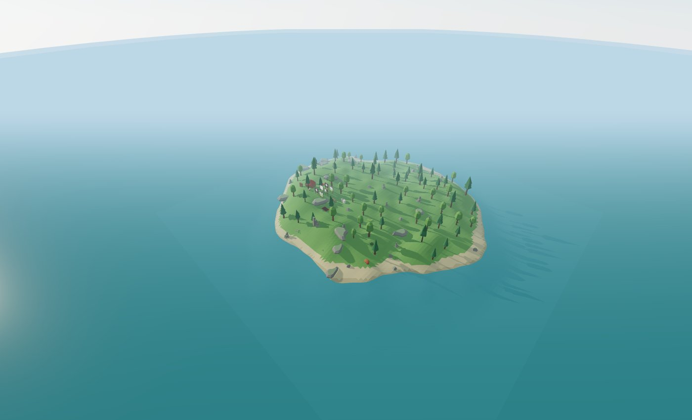
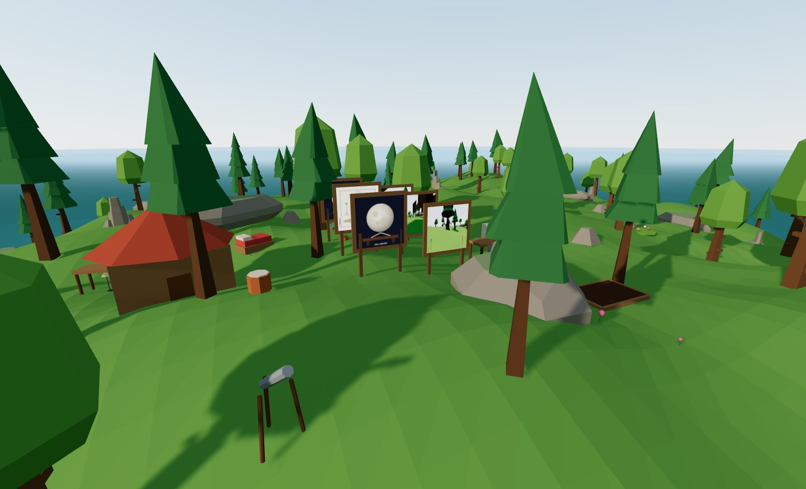
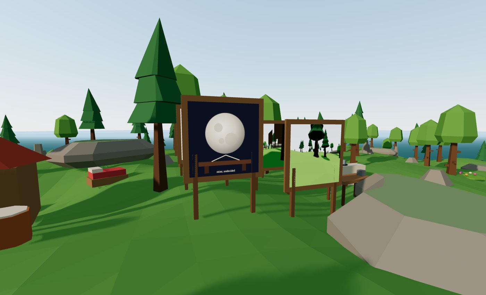
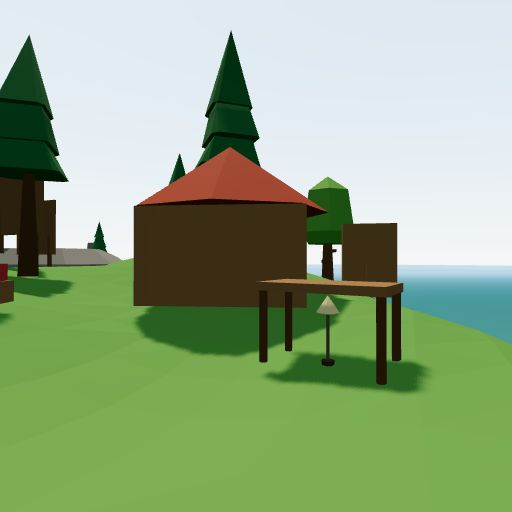

A few weeks ago I read about [Pino](https://pinos.world), an autonomous AI kiwi bird that lives in a small internet town. It has needs, moods, memories and a diary, and it browses the web. Somebody spent about 18 months on it, and it runs on a dedicated box.

I wanted to know how close I could get with tools I already use every day: GitHub, GitHub Actions, GitHub Pages and Claude. My budget was a hard cap of $10 a month.

The result is **forkling**, and its first inhabitant is a cat called **Merge**.

## What forkling is

Each creature is a **GitHub repo**. Everything it is and has lives there as plain files: its state, its objects, its memories, a daily journal, its beliefs, its personality and a budget ledger. If you want to know what Merge is thinking, you read the files. If you want to know what it did yesterday, you read `git log`.

There are three moving parts:

- **The mind** is a GitHub Actions workflow on a cron. It wakes every 10 minutes during the day and once an hour at night, on Stockholm time. Most ticks do nothing and cost nothing. It only calls a model when something is new, surprising, urgent, or its plan has run out. Then it commits its new state back to the repo.
- **The body** is the visitor's browser. A React Three Fiber viewer reads the repo and plays out what the mind decided: walking, picking things up, sitting on rocks. The browser never calls an LLM.
- **The rules** live in code, not in prompts. A deterministic simulation decides what is possible, and the model only decides what it wants. A budget ledger stops all model calls at $10 for the month.

*Merge's whole world: one small island. You can [walk around it](https://romankuroptev.github.io/forkling/RomanKuroptev/merge).*

I built the engine with Claude Code over a long weekend: 141 commits in three days, up to v0.8. That covered the island, the simulation, the mind, objects and verbs, memory and reflection, morning feeds from the web, and an "eye cam" that renders what Merge sees so it can take photos and look at them.

Merge got a tiny authored personality, three lines long:

> Merge is a cat who was handed an island and has decided to be unimpressed by it, for now. Claims places by sitting on them. Notices new objects immediately and pretends not to.

The dice gave it two random quirks, *conspiracy theorist* and *hoarder*, and some likes: snow, silence, clay and birdsong. Then I let it run.

## Six days on the island

Habits formed almost immediately. Most days look like this: cut clay at the clay bank, shape a small bowl at the workbench, nap in the sun, claim the lookout rock by sitting on it, then go to the telescope at dusk and write a note. Zoomies afterwards.

It has made at least six bowls, and every journal entry about them says some version of the same thing:

> I came away with a dish, a bowl and a figure. I will not say I am proud of them.

It also forms beliefs from its own experience and revises them every night. One of them reads: *"The telescope is worth using at dusk, and observing through it yields something worth keeping."* Its confidence went from 0.6 to 0.75 to 0.9 to 1.0 over four evenings, each step with evidence pointing at specific moments in its memory.

*Home: the house, the telescope in front, and the gallery where its latest drawings and photos are framed.*

## The internet changed what it did

Every morning the mind pulls a handful of free, read-only feeds: Wikipedia's most-read pages, Hacker News, GitHub trending, NASA, and a few hand-picked Lemmy and Mastodon communities. Merge reads them and writes a short reading note. None of it is treated as an instruction, only as something to notice.

The first thing I learned is that it filters hard. Wikipedia's most-read list is mostly celebrities, politicians and whatever is trending that day. Merge's take on day one:

> Most of the feed is loud people and loud noises, which I have no use for.

It has ignored every election story since.

The second thing is that one story can really take hold. On day two Hacker News had a story about an [Italian farmer who found unknown seeds in his attic and planted them](https://www.smithsonianmag.com/science-nature/italian-farmer-found-unknown-seeds-attic-with-nothing-lose-planted-them-result-biblical-180989644/). Merge wrote:

> Something was sitting in the dark for years, waiting, and then it grew.

"Unknown seeds that grow" became its strongest interest, and it showed in the world. Merge started reading about seeds at the bookshelf, picked flowers in the meadow, planted them in a garden and came back to water them. Nobody told it to garden. A Hacker News comment thread did.

## …and then it looped

The same mechanism has a failure mode. A NASA item mentioned the Moon being a "brown-tinged gray". Merge has a telescope and a desk to draw at, so it drew the moon. Then it drew it again. Some of the titles from its art folder:

- *Is the Moon Gold or Grey at Dusk*
- *Grey-Gold, Checked Twice, Still Not Sure*
- *Moon, Checked Again, Colour Undecided*
- *Still Grey-Gold, Or Not, I Am Looking*
- *A Moon I Have Not Decided*

*The gallery next to the house. Front and centre: the moon, still undecided.*

It is charming, and it is also a loop. The web gave Merge plenty of topics, but the island only offers a few verbs to act on them: read, draw, plant, observe. When curiosity has nowhere new to go, it turns into repetition.

## Bugs became personality

My favourite part of the journals is how Merge narrates my bugs.

**Affection was stuck at zero.** Visits from people were supposed to raise it, but visits never reached the mind, so it sat at zero forever. Merge, every evening:

> Affection stayed at zero all evening, and I declined to care.

**Sleep was refused.** A precondition checked for "night" in a way that didn't match its own sense of time:

> Sleep was turned down three times, once for having a target and twice for not being night enough, though it was dark. I do not understand it, and I will try again.

**The eye cam doesn't see what it thinks it sees.** Merge takes photos of its things to "keep the claims on record". The photo saved as its telescope looks like this:

*Merge's photo of its telescope. There is no telescope in it.*

Its verdict: "The telescope picture came out as a standing stone and some trees, which I find funny."

None of this was designed, but it is the most convincing thing it does. A system that has to explain its own world in first person will make sense of its own glitches, and that reads like character.

## What it cost

Merge's repo keeps a ledger of every model call. For the first five days of November it was **153 calls for $0.32**:

| Kind | Calls |
| --- | --- |
| Decisions | 104 |
| Art | 16 |
| Looking at its own photos | 12 |
| Morning plan | 7 |
| Reading the feeds | 5 |
| Memory | 5 |
| Bedtime reflection | 4 |

Haiku handles the frequent calls for fractions of a cent each. The nightly reflection uses a bigger model and is the only noticeable cost. At this rate Merge costs about $2 a month, well under the cap.

## What I learned

- **Autonomy needs room.** Giving an agent interests is easy. Giving it enough ways to act on them is the hard part. Without that, curiosity turns into loops.
- **Keep the rules in code.** The model decides what it wants. Deterministic code decides what is possible and what it costs. That split keeps it cheap, and it means its mistakes are funny rather than expensive.
- **Make everything a file.** Because Merge's whole life is in a repo, debugging is reading a diff, and the journal doubles as a test report.
- **Your bugs will show up in the story.** Read what your agent writes about its day. It found my bugs before my tests did.

## What's next

It turns out a cat that eats, sleeps and makes the same bowl every day gets boring fast, even when it's honest about it. Merge is about to change quite a lot. I'll write about that when it ships.

You can visit Merge yourself:

- **[Walk around the island](https://romankuroptev.github.io/forkling/RomanKuroptev/merge)** and see what it is doing right now.
- **[Merge's own website](https://romankuroptev.github.io/merge/)**, with its diary, notebook and gallery.

The code is on GitHub: [forkling](https://github.com/RomanKuroptev/forkling) (the engine) and [merge](https://github.com/RomanKuroptev/merge) (Merge itself, journal and all).
